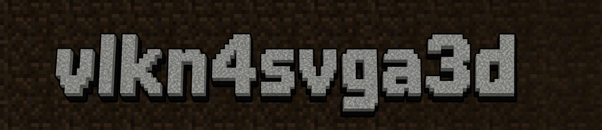

<p align="center">
  
</p>

# vlkn4svga3d

An experimental Vulkan renderer for VMware SVGA3D, with a standalone C API and QEMU integration.

The project translates legacy Direct3D 9-style graphics commands and shaders into Vulkan, allowing virtual machines using the VMware SVGA device to render through a host Vulkan driver.

Support is incomplete. DirectX 10/11 rendering is unsupported, and guest compatibility varies.

## Performance

| Renderer | glmark2 score¹ | Relative score |
| --- | ---: | --- |
| **vlkn4svga3d** | **647** | ████████████████████ |
| Mesa llvmpipe | 193 | ██████ |

**Specs:** Intel Core i5-7500T · Intel HD Graphics 630 · Debian 12 guest · 2 vCPUs · 800×600.

¹ Median scores from separate runs; terrain is unsupported by vlkn4svga3d.

## Build

Requires a C++17 compiler, GNU Make, and a Vulkan driver. Vulkan headers are bundled.

On Debian or Ubuntu:

```sh
sudo apt install build-essential libvulkan1 mesa-vulkan-drivers
make -j4 all
```

## Use as a library

Install the library and public headers:

```sh
sudo make install PREFIX=/usr/local
```

Build and run the [C example](examples/embed.c):

```sh
cc examples/embed.c $(pkg-config --cflags --libs svga3-vlkn) -o embed
./embed
```

The API is declared in [include/svga3_vlkn.h](include/svga3_vlkn.h). Initialize a configuration with `svga3_vlkn_config_init()`, then create a device with `svga3_vlkn_device_create_ex()`.

## Use with QEMU

The [QEMU integration guide](integrations/qemu/README.md) explains how to build the patched QEMU 9.2.0 device. Enable the renderer with:

```sh
-device vmware-svga,vlkn=on
```

This requires the project's QEMU patch. Migration and snapshots are unsupported.

## Test

```sh
make test        # Basic checks using the mock backend
make acceptance  # Broader suite, including Vulkan rendering
```

Vulkan tests require a working driver and validation layers. See the [testing guide](docs/testing.md) for dependencies and individual suites.

## License

GPL-2.0-or-later, with third-party notices. See [LICENSE.md](LICENSE.md) and [COPYING](COPYING).
